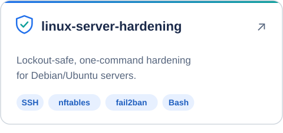
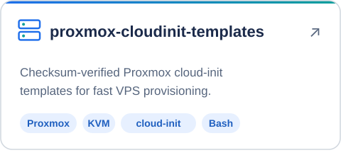
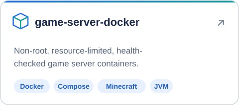
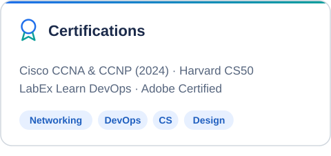

<picture>
  <source media="(prefers-color-scheme: dark)" srcset="assets/header-dark.svg">
  
</picture>

  
  
  

 

<picture>
  <source media="(prefers-color-scheme: dark)" srcset="assets/terminal-dark.svg">
  
</picture>

  

<h3 align="center">Tech stack</h3>

  <picture>
    <source media="(prefers-color-scheme: dark)" srcset="https://skillicons.dev/icons?i=linux%2Cdebian%2Cubuntu%2Cbash%2Cdocker%2Ckubernetes%2Caws%2Ccloudflare%2Cnginx%2Cjenkins%2Cgit%2Cpython&perline=12&theme=dark">
    
  </picture>
   
  <picture>
    <source media="(prefers-color-scheme: dark)" srcset="https://skillicons.dev/icons?i=php%2Claravel%2Creact%2Cts%2Ctailwind%2Cmysql%2Credis%2Ccpp%2Ccs%2Cdotnet%2Cjava%2Cunity&perline=12&theme=dark">
    
  </picture>

 

<h3 align="center">Featured work</h3>

  <a href="https://github.com/Ahmad-SDev/linux-server-hardening"><picture><source media="(prefers-color-scheme: dark)" srcset="assets/card-hardening-dark.svg"></picture></a>
  <a href="https://github.com/Ahmad-SDev/proxmox-cloudinit-templates"><picture><source media="(prefers-color-scheme: dark)" srcset="assets/card-proxmox-dark.svg"></picture></a>
  <a href="https://github.com/Ahmad-SDev/game-server-docker"><picture><source media="(prefers-color-scheme: dark)" srcset="assets/card-docker-dark.svg"></picture></a>
  <a href="https://www.linkedin.com/in/ahmed-morsy-ngx/details/certifications/"><picture><source media="(prefers-color-scheme: dark)" srcset="assets/card-certs-dark.svg"></picture></a>

