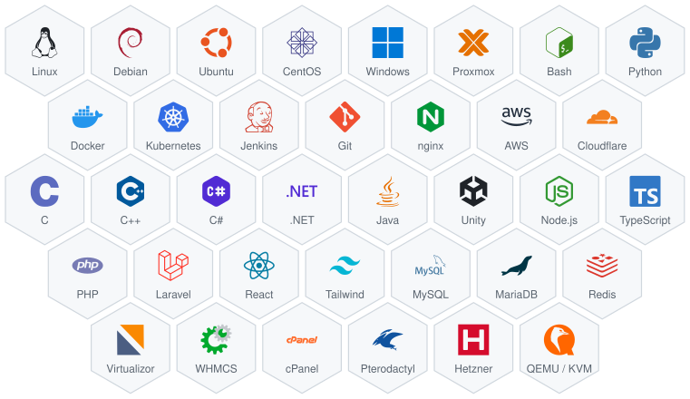

  

  
  
  

### About me

- I run the infrastructure at [MAHosting](https://magoods.org): VPS, dedicated and game servers
- We run our own network on BGP, with DDoS filtering we wrote on XDP/eBPF
- Most days: Proxmox, Docker, nginx, Linux hardening and automation
- 7+ years of code: PHP/Laravel, React/TypeScript, C#, C++ and Unity
- I've been making games and mods since I was 15
- In 2023 I founded Akhdar and taught Java and C to 300+ Princess Nourah University students ([lectures on YouTube](https://www.youtube.com/@MinasatAkhdar/videos))
- I use Claude Code, Codex and Cursor every day
- Most of my work lives in private company and client repos
- Reach me on [LinkedIn](https://www.linkedin.com/in/ahmed-morsy-ngx/) or at **ahmedmorsydev@gmail.com**

### Tech stack

  <picture>
    <source media="(prefers-color-scheme: dark)" srcset="assets/honeycomb-dark.svg">
    
  </picture>

### Certifications

  
  
  

