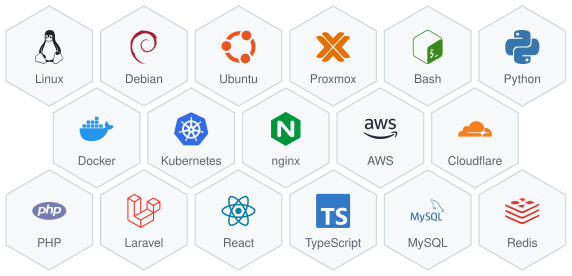

### Hi, I'm Ahmed

I'm a DevOps and cloud engineer in Alexandria, Egypt. I co-founded [MAHosting](https://magoods.org) and run the technical side: VPS, dedicated and game server hosting on our own BGP network, with DDoS filtering we built in-house on XDP/eBPF.

Most of my time goes into Linux servers, Proxmox, Docker and networking. Before hosting I spent years writing code, mostly PHP/Laravel and React, plus C#, C++ and Unity for games.

A few small tools I've made public:

- [linux-server-hardening](https://github.com/Ahmad-SDev/linux-server-hardening): sets up a fresh Debian/Ubuntu server. It won't turn off password login until an SSH key is in place.
- [proxmox-cloudinit-templates](https://github.com/Ahmad-SDev/proxmox-cloudinit-templates): builds Proxmox VM templates from the official cloud images and checks the checksums first.
- [game-server-docker](https://github.com/Ahmad-SDev/game-server-docker): a Minecraft (Paper) server in a non-root container with CPU and RAM limits.

Most of my other work lives in private company and client repos.

**What I use day to day**

<picture>
  <source media="(prefers-color-scheme: dark)" srcset="assets/stack-dark.svg">
  
</picture>

**Certs:** Cisco CCNA and CCNP (2024), Harvard CS50

You can find me on [LinkedIn](https://www.linkedin.com/in/ahmed-morsy-ngx/) or email me at ahmedmorsydev@gmail.com.
